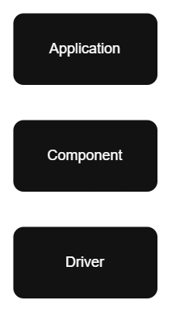

# 1. Introduction: Three-Layer Architecture

When you develop firmware for a single device, keeping everything in one project is often enough. But when you design a system with many units that can be added or removed, and with multiple product variations, you need an architecture that guides how the code is structured.

In these articles, we will discuss practical steps you can adapt to your own needs. The goal is to define a structure that makes your code reusable, modular, and easy to replace—so changing one module has little or no impact on the rest of the system.

At a minimum, and without making things more complex than needed, you should have three layers: the Driver layer, the Component layer, and the Application layer.

## Driver layer

This layer separates your code from the hardware. If you change the microcontroller, you mainly update this layer. The rest of your code stays largely unaffected.

## Component layer

This layer holds reusable units you can share across projects. That includes hardware-related units such as sensors, motors, and other devices, as well as software logic such as algorithms, general libraries, and encode/decode modules. When a component needs hardware access, it talks to the driver layer, so a hardware change does not force you to rewrite the component.

## Application layer

This layer forms the actual projects that produce binaries for your ECUs/Microcontrollers. It uses drivers and components as modules, so you reuse the logic you already built instead of rewriting it for every product.