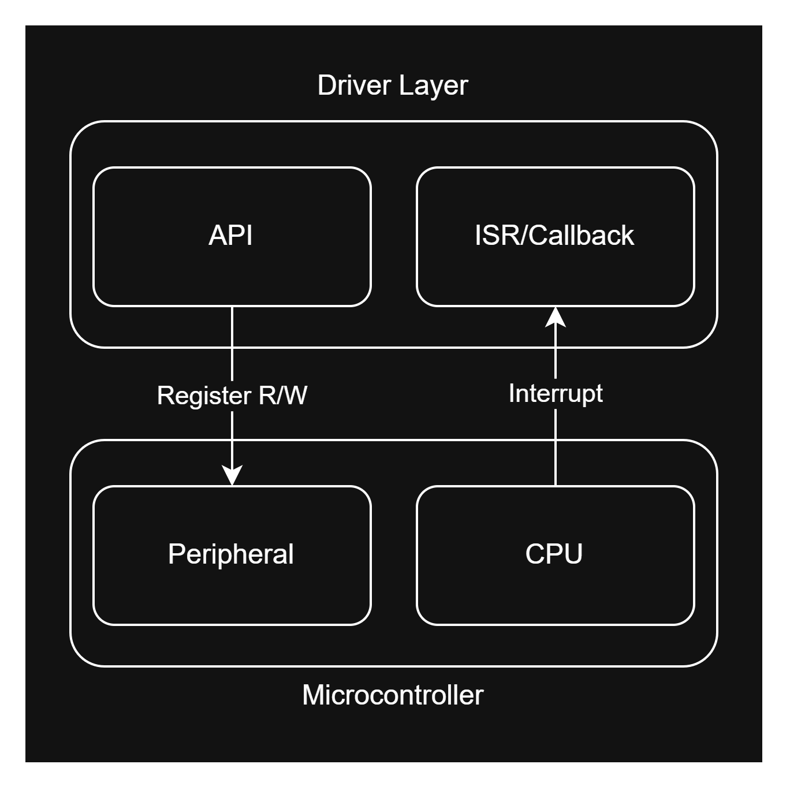

# 2. Driver Layer: Hardware Abstraction

The Driver layer isolates the Component and Application layers from the hardware-specific details. It does that by exposing a consistent set of APIs and ISR interfaces. So, when you change the microcontroller, you do not need to change or re-implement the upper layers, instead, you only re-implement the driver layer for the new device.

To design this layer, we need to define how software interacts with the hardware. On bare-metal and RTOS-based microcontrollers, software interacts with hardware in two main ways:

1. **Software-to-hardware:** Accessing peripherals through registers or driver APIs.
2. **Hardware-to-software:** Handling CPU interrupts through ISRs.

So, we need to implement APIs for direct hardware register access, and ISRs for CPU interrupt handling. 

Also, for acheiving the maximum performance, we will use **C Programming Language** for this layer.

Every driver module consists of:

- **Header files**
  - Each driver should expose its APIs and ISR declarations in a header.
  - These APIs can be functions, macros, or inline functions.
  - Header files should also define the data types required to interact with the hardware (for example, if it is a driver for **CAN peripheral,** then we need to create data types for CAN handlers and filter bank configuration structures).
  - These files serve as the interface for the other layers.
  - You can optionally split related declarations across multiple headers—for example, APIs in one file and ISRs in another.
- **Source files**
  - These files contain the actual implementation of the driver APIs and ISRs.
  - Give ISR default implementations the `weak` attribute so that when a developer provides a callback in the application, the linker does not report a multiple-definition error.

---

## Implementation Approaches

You can implement the driver layer in one of two approaches:

1. **Access hardware registers directly and define interrupt vector handlers**

- This gives the best performance because you avoid extra function-call overhead. 
- However, the trade-off is slower development, since you work at a low level. 
- Prefer this approach for critical drivers where performance / CPU cycles matters most.

2. **Wrap existing hardware-abstraction APIs and ISR callbacks from an underlying library**

- This approach speeds up development by relying on existing driver libraries. 
- You wrap the library APIs with your driver’s APIs, and wrap the library's ISRs with your driver ISRs.
- Also, by following this approach you can use code-generation tools that configure peripherals for you (for example, STM32CubeMX for STM32 devices).
- The cost is a small performance hit from the extra function calls. That is the trade-off: faster development versus slightly lower performance.

---
