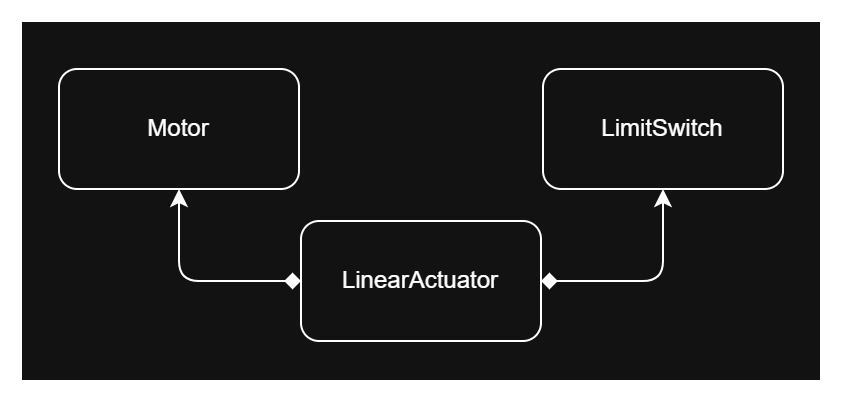

# 3. Component Layer: Reusable Software Units

This layer encapsulates the functionality and members of a unit into portable, hardware-decoupled software components. The goal is to create reusable units that you can integrate into different projects without having to rewrite their logic.

These units can take different forms:

- **Hardware-related units:** Abstractions of devices that involve hardware interaction, such as motors, sensors, and other peripherals.
- **Software-related units:** Reusable software logic, such as encryption, encoding/decoding modules, algorithms, and state machines.
- **Other portable software units** that can operate independently of a specific hardware implementation.

Based on these requirements, we will use **C++ and Object-Oriented Programming (OOP)** to implement the components in this layer.

Each component will consist of a class that encapsulates its members and behavior. This allows you to create multiple instances (objects) of the same class within your application, depending on your needs. For example, if your system has multiple motors, you can create multiple motor objects from the same class, each maintaining its own configuration and state.

A component may also consist of multiple classes that work together to achieve its required behavior. This allows you to combine smaller, reusable components to create more complex ones.

When it comes to hardware interaction, the component will use the required hardware driver from the Driver Layer as a dependency. It will hold a member of the driver's handler data type and use the driver's APIs within its methods to implement the required logic.

This way, the component handles the device's functionality without being tied to the underlying hardware implementation, making each component portable across different projects.

### Benefits of Using OOP in This Layer

- **Maintainability:** The logic is encapsulated within the component's class, making maintenance easier. Modifications and fixes can be handled within the component without affecting the rest of the application.
- **Reusability and composition:** You can reuse existing components to create more complex components composed of multiple other components. For example, you can create a `LinearActuator` component consisting of one `motor` object and two `LimitSwitch` objects.

- **Design patterns:** You can apply design patterns to organize component behavior and achieve more flexible implementations. For example, the State and Strategy patterns can help you implement different behaviors.
