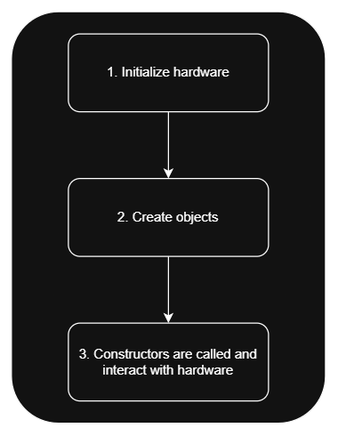

# 5. Rule 1 - Use a Single Constructor

Let's start with the first OOP development rule we established in the previous article: **using a single constructor**.

Each component should have only one constructor, providing a consistent way to create and initialize its objects.

### Make sure all peripheral handlers are provided to the component

The main reason behind this rule is that our components will most likely interact with hardware. Therefore, we want to ensure that all the required dependencies, such as peripheral handlers (**GPIO, CAN, etc.**), are provided when creating the object.

For example, a `LimitSwitch` component requires a **GPIO** (Digital Input) to operate.

---

### The constructor will handle the initialization logic of the component

Additionally, the constructor should be responsible for handling any initialization logic required by the component. This eliminates the need for separate `Initialization()` methods that developers must manually call throughout the application.

The goal is simple: **create the object, and it should be ready to use.**

However, when we talk about hardware initialization at the component level, we don't mean initializing the hardware peripheral itself. Instead, we mean performing any initialization operations that the component requires through an already configured peripheral.

For example:

- A `LimitSwitch` component might need to read the initial state of its GPIO pin.
- A **Power IC** communicating over **I2C** might require an initialization message to be sent once at startup.

In other words, initializing the peripheral itself is the responsibility of the **Driver Layer** or any hardware code-generation tool being used, such as **STM32CubeMX** for STM32 microcontrollers.

The component only handles its own initialization requirements by interacting with peripherals that have already been configured.

This brings us to the last point of this rule: **when should we create component objects?**

---

### When to instantiate component objects

We cannot create these objects just anywhere. For example, defining them as global variables means their constructors will execute before the required peripherals are initialized, even before entering `main()`. This can lead to accessing uninitialized hardware or reading invalid data, potentially causing serious issues such as a core dump, unexpected system behavior, or difficult-to-trace initialization bugs. It may also leave the component in an inconsistent state.

Therefore, we must follow a specific initialization order

1. Initialize the hardware peripherals.
2. Create the component objects.



Here's a code snippet demonstrating this order:

```cpp
#include "main.h"
#include "GPIO_Driver.h"
#include "LimitSwitch.h"

int main()
{
    // Hardware initialization:
    Hardware_Init();

    // Create component objects after hardware initialization:
    LimitSwitch limitSwitch(GPIOA_Pin11);

    while (1)
    {
        // Application logic:
        limitSwitch.Update();
    }
}
```

---

