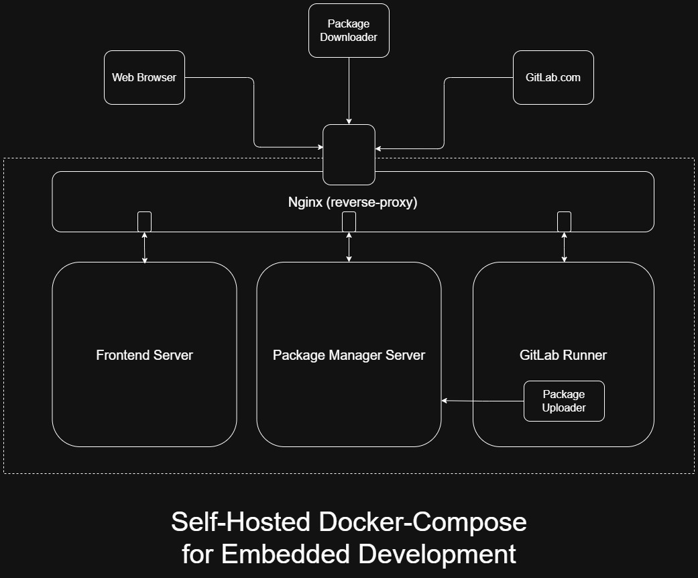
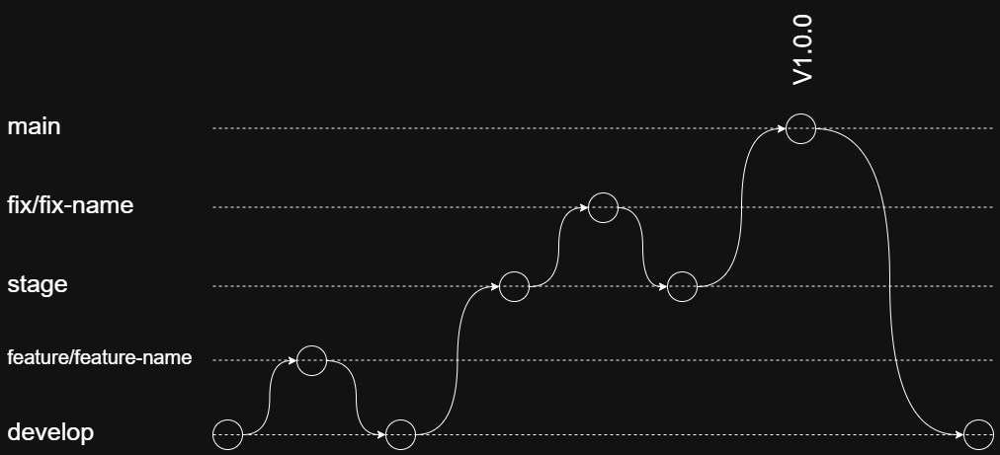

# 1. Introduction

In the previous series, [Designing Software Architecture for Modular Embedded Software Development](https://shukridozom.com/articles/1-designing-software-architecture-for-modular-embedded-software-development/), I introduced a three-layer architecture that separates embedded software development into three layers: **Driver, Component, and Application**.

This series focuses on preparing a development framework to support this architecture, particularly the development, artifact building, deployment, and integration of its different software units.

## **Development Framework Infrastructure**

The framework is built around a Docker Compose environment that provides the required infrastructure for package management and automated development pipelines. It consists of the following units:

- **Nginx:** Acts as a reverse proxy, routing incoming requests to the appropriate services based on their URL paths.
- **Package Manager Server:** A .NET 9 application built with C# that handles package storage, uploads, downloads, and package management APIs.
- **GitLab Runner:** Executes CI/CD pipelines for validating, building, tagging, and deploying software projects. Connects to repositories hosted on **GitLab.com**.
- **Package Uploader:** A custom CLI tool built with C# used during the deployment stage of CI/CD pipelines to publish packages along with their metadata to the Package Manager Server.
- **Package Downloader:** A custom CLI tool built with C# used during development to retrieve required package dependencies, including their nested dependencies recursively.
- **Frontend Server:** Hosts the web interface to fetch and view available package metadata.




## Project Types and Deployment

Every project lives inside its own **GitLab** repository and follows a three-branch workflow throughout its development lifecycle: **develop**, **stage**, and **main**.

- **develop:** Integrates new features and ongoing development changes.
- **stage:** Used for testing the project and fixing identified bugs before release.
- **main:** Triggers the release pipeline, which handles versioning, building, and deploying the project.



The framework handles two types of projects based on their output/artifact types:

### **1. Code-artifact projects**

**Code-artifact** projects ****represent the **Driver** and **Component** layers. Their output consists of reusable code units/libraries, which are packaged and distributed through the Package Manager Server along with their metadata.

### **2. Binary-artifact projects**

**Binary-artifact** projects make upthe **Application** layer. They integrate the required **Drivers** and **Components** to produce the final firmware binary for an ECU or microcontroller.

## Project Metadata

Each project maintains a metadata file describing its version, backward compatibility, and dependencies.

```json
{
    "version": "0.1.0",
    "backward_compatibility": true,
    "dependencies": {
        "UART_Driver": "1.0.2",
        "ServoMotor": "2.0.1"
    }
}
```

The metadata fields have the following purposes:

- **version:** Specifies the version of the project to be released next.
- **backward_compatibility:** Indicates whether the new version is backward-compatible with the previous version. This information is used when resolving dependencies between packages.
- **dependencies:** Lists the required packages and their versions.

## Dependency Resolution

During development, both code-artifact projects (Drivers and Components) and binary-artifact projects (Applications) use the dependency list to retrieve their required packages through the Package Downloader CLI. The downloader also resolves nested dependencies and checks for version conflicts.

For example, assume we have the following packages:

- `GPIO_Driver` has two versions: `v1.0.0` and `v2.0.0`. Version `v2.0.0` is backward-compatible with `v1.0.0`.
- `LimitSwitch` has one available version, `v1.0.0`, which depends on `GPIO_Driver v2.0.0`.

Now, consider an application project that specifies the following dependencies:

```json
{
    "LimitSwitch": "1.0.0",
    "GPIO_Driver": "1.0.0"
}
```

Although the application explicitly requests `GPIO_Driver v1.0.0`, the `LimitSwitch` dependency requires `GPIO_Driver v2.0.0`.

Since `GPIO_Driver v2.0.0` is marked as backward-compatible with the previous version, the Package Downloader can resolve this requirement by pulling `GPIO_Driver v2.0.0` instead of `v1.0.0`.

If the required update is not backward-compatible, the downloader reports a version conflict instead of silently replacing the requested version.

## **Dependency Deployment**

Although both project types use dependencies during development, they handle them differently during deployment.

- **Code-artifact projects (Drivers and Components):** Their dependency information is published to the Package Manager database along with the package. This allows the **Package Downloader CLI** to automatically retrieve the package and its required dependencies, including nested dependencies, whenever another project uses it. This ensures that all required dependencies are resolved during package retrieval without requiring developers to manage them manually.
- **Binary-artifact projects (Applications):** Their dependencies are only used during development to retrieve the required packages and build the firmware binary. They are not published as package dependencies because the output is an executable binary rather than a reusable code package.